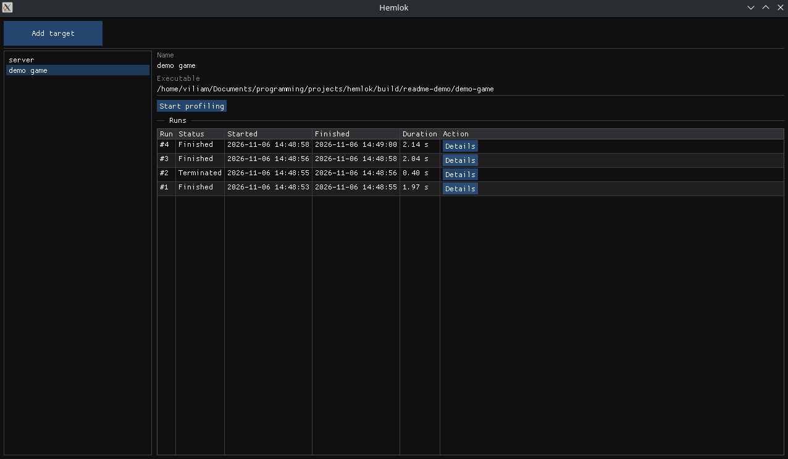
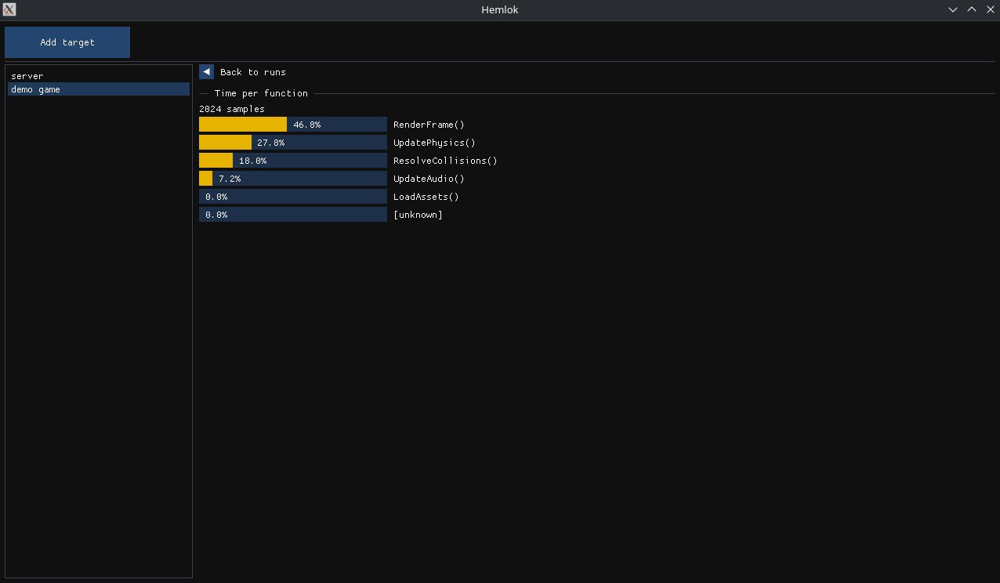

# Hemlok

A small sampling profiler for Linux. Point it at an executable, run it, and see
where the time went.





## Build and run

Requires Linux, CMake 3.20+, a C++23 compiler, and OpenGL.

```sh
cmake -S . -B build
cmake --build build
./build/hemlok
```

Sampling uses `perf_event_open`, so unprivileged users need
`kernel.perf_event_paranoid` set to 2 or lower:

```sh
sudo sysctl -w kernel.perf_event_paranoid=2
```

## Limitations

- Single-threaded programs only.
- Flat, per-function view; no call stacks.
- Functions from stripped libraries show up as `[unknown]`.

## Development

```sh
ctest --test-dir build --output-on-failure   # run tests
./scripts/format.sh                          # format sources
git config core.hooksPath .githooks          # check formatting on commit
```

CI builds and tests on Ubuntu and checks formatting on every push and pull
request to `main`.

## License

[MIT](LICENSE)
